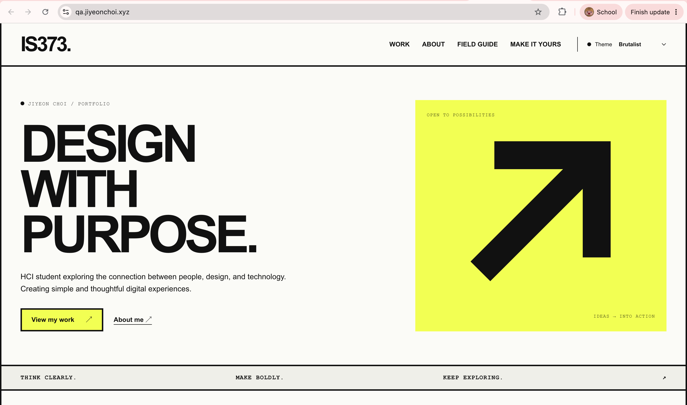
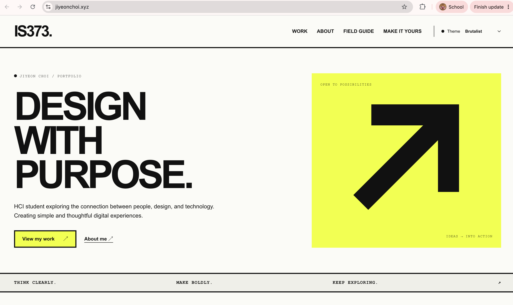
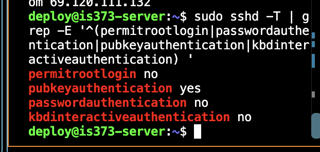
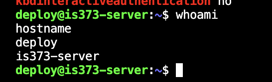

## Live Deployment

- **Production:** https://jiyeonchoi.xyz
- **QA:** https://qa.jiyeonchoi.xyz
- **GitHub Repository:** https://github.com/jec87/is373_fall2026

# IS373 — Your professional home on the web

Your first project in Content Management Systems is to begin building a personal web presence. Use AI to help develop it, Docker to run it consistently, and a discovery process to decide what it should communicate. You should be able to explain both your choices and the work behind them.

**This phase is discovery and the existing portfolio starter.** Content lives in local project files. A CMS, blog, QR-code integration, and additional publishing capabilities come later; they are not prerequisites for getting started.

## Start here

1. Read [The project and its purpose](docs/project-overview.md).
2. Set up Docker: [Mac](docs/setup-mac.md) or [Windows with WSL 2](docs/setup-windows.md).
3. Follow [Run the app](docs/run-the-app.md). Docker supplies Node.js; a separate Node installation is optional.
4. Work through [Discover your direction](docs/discovery.md), recording your own answers.
5. Use [Make this portfolio yours](docs/portfolio-starter.md) for your first small edits.

## Three parts of one project

| Part                        | Start with                                                     | What you should be able to explain                                                     |
| --------------------------- | -------------------------------------------------------------- | -------------------------------------------------------------------------------------- |
| AI-assisted development     | [Working with AI](docs/working-with-ai.md)                     | What you asked for, what changed, how you checked it, and what you learned.            |
| Docker and containerization | [Docker explained through this project](docs/docker-basics.md) | How your code, image, container, ports, and storage work together.                     |
| Your portfolio and message  | [Discovery, design, and persuasion](docs/discovery.md)         | Who you want to reach, what you offer, what evidence supports it, and the next action. |

## What is already here?

The application includes a homepage, About page, sample case-study pages, four themes (Brutalist, Base, Swiss, Punk), and a theme studio. Its field guide covers Cialdini, illustrated design history, and brand archetypes. The archetype planner can download a working brief. Sample projects are teaching examples, not finished student work.

After starting the app, explore `/work`, `/about`, `/studio`, and `/learn`. Supplementary course guidance lives in the Markdown documents linked here, so you can read it before the app is running.

## Reference and next steps

- [Student discovery brief template](docs/discovery-brief-template.md) — copy and complete in your own words.
- [Project map and agent handoff](docs/project-map.md) — where to edit and how another agent can understand your work.
- [Development reference](docs/development.md) — checks, local Node workflow, and production Docker commands.
- [Long-term vision](docs/project-vision.md) — how the website, blog, GitHub, LinkedIn, QR code, and a later CMS can fit together.
- [Agent instructions](AGENTS.md) — repository conventions and current scope.

Begin with a running starter, a discovery brief, and one small change you understand. Expand the project as the course introduces new capabilities.

## CI/CD Deployment and Server Security

### Live Websites

- **Production:** https://jiyeonchoi.xyz
- **QA:** https://qa.jiyeonchoi.xyz
- **GitHub Repository:** https://github.com/jec87/is373_fall2026

Both websites are hosted on a DigitalOcean Droplet using Docker and HTTPS.

### CI/CD Pipeline

The project uses GitHub Actions to automate testing, building, publishing, and deployment.

1. Code is pushed to the `qa` or `main` branch.
2. GitHub Actions validates the application and builds a production Docker image.
3. The Docker image is published to GitHub Container Registry (GHCR).
4. Changes pushed to `qa` automatically deploy to the QA environment.
5. Tested changes are promoted to `main` for production deployment.
6. Deployment includes container health checks and rollback logic.

**Container Registry:** `ghcr.io/jec87/is373_fall2026`

**Image Tag:** Git commit SHA (`github.sha`).

### GitHub Actions Evidence

- [Successful CI Workflow](https://github.com/jec87/is373_fall2026/actions)
- [Successful QA and Production Deployment](https://github.com/jec87/is373_fall2026/actions)

The CI, QA, and production workflows were successfully verified on October 15, 2026.

### Server Security

The DigitalOcean server uses Ubuntu 24.04 LTS with a non-root deployment account.

Verified SSH configuration:

- Root SSH login disabled.
- Password authentication disabled.
- Public-key authentication enabled.
- Keyboard-interactive authentication disabled.
- SSH host key verification enabled for deployments.

A DigitalOcean cloud firewall protects the server, allowing inbound traffic on ports 22 (SSH), 80 (HTTP), and 443 (HTTPS).

### Deployment Verification

Both QA and production Docker containers passed their health checks. The production website returned HTTP 200 over HTTPS after deployment and firewall configuration.

The CI and production deployment workflows completed successfully, and the production website remained accessible.

## Test Evidence

### CI/CD Workflow

- **GitHub Actions:** https://github.com/jec87/is373_fall2026/actions
- **Docker Image Registry:** https://github.com/jec87/is373_fall2026/pkgs/container/is373_fall2026
- **Production Website:** https://jiyeonchoi.xyz
- **QA Website:** https://qa.jiyeonchoi.xyz

The CI/CD pipeline runs when changes are pushed to the `qa` or `main` branches. GitHub Actions validates the application, builds a Docker image, and publishes it to GitHub Container Registry. Successful changes on `qa` deploy to the QA website. Changes merged into `main` deploy to production.

### QA to Production Demonstration

**Successful QA Deployment:** https://github.com/jec87/is373_fall2026/actions/runs/38762594547

**Successful Production Deployment:** https://github.com/jec87/is373_fall2026/actions/runs/38767834062

**QA Deployment Commit:** `77686ae`

**Production Deployment Commit:** `b2502fd`

**QA Website Screenshot**

**Production Website Screenshot**

### SSH Security Verification

The server uses the non-root `deploy` account with SSH-key authentication.

Verified SSH settings:

- `permitrootlogin no`
- `pubkeyauthentication yes`
- `passwordauthentication no`
- `kbdinteractiveauthentication no`

**Evidence to attach:**

- Screenshot showing successful SSH login as `deploy`.
- Screenshot showing the effective SSH configuration.

- **Successful QA Workflow:** https://github.com/jec87/is373_fall2026/actions/runs/38762594547
- **Successful Production Workflow:** https://github.com/jec87/is373_fall2026/actions/runs/38767834062
- **QA Commit:** `77686ae`
- **Production Commit:** `b2502fd`

**QA Website Screenshot**

**Production Website Screenshot**

**SSH Security Evidence**

**Non-Root SSH Login Evidence**

